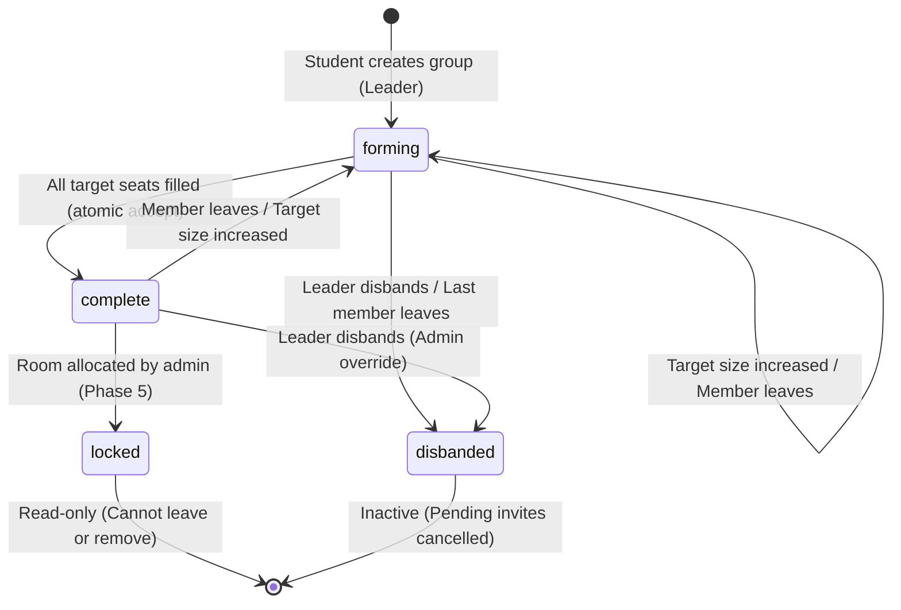

# HostelMatch 🏢🤝

> **Smart Hostel Allocation and Roommate Matching System**  
> A modular, generic, and configurable full-stack platform built for any college, university, or higher education institution.

---

## 📌 Project Overview

**HostelMatch** is an enterprise-ready platform for student residential accommodations. Instead of being hard-coded for a single institution, it decouples institutional rules, room quotas, and preference criteria into a generic configuration schema.

### Core Architecture & Features
- **Full-Stack Next.js App Router**: Client components, Server Components, and REST Route Handlers.
- **Robust Database Connectivity**: Mongoose with global connection caching for serverless environments.
- **Authentication & Role-Based Access (Phase 2)**:
  - **Jose JWT**: Universal token signing/verification across Node.js & Edge runtimes.
  - **httpOnly Cookies**: Stored in secure `hm_token` cookies (never exposed to `localStorage`).
  - **Role Guards**: Strict separation between `student` and `admin` portals (`requireAuth`, `requireRole`).
  - **Route Protection (`src/proxy.js`)**: Modern Next.js 16+ proxy intercepting unauthorized page accesses.
- **Hostel & Room Management (Phase 2 - Part 1)**:
  - **Hostel Model**: Code uniqueness, gender designations (`boys`, `girls`, `mixed`), floor bounds, academic year eligibility, facilities, and rules.
  - **Room Model**: Compound index `(hostel, roomNumber)`, floor validation, capacity (1-6), types (`AC`, `Non-AC`), occupancy tracking, auto-status pre-save hook.
  - **High-Performance MongoDB Aggregations**: Pre-computed bed totals, occupancy metrics, and per-hostel breakdowns without N+1 query overhead.
  - **Student Eligibility Controls**: Students only see active hostels and safe room information matching their gender and year. Occupant identities and internal admin notes are strictly hidden.
  - **Occupancy Protections**: Rejects hostel gender changes or deletions if rooms are occupied; rejects lowering room capacity below current occupancy.
  - **Bulk Room Creation**: Admin generator creating up to 200 rooms per batch with duplicate skipping and live preview.
  - **Sample Demo Seeding**: Idempotent generator (`npm run seed:hostels`) creating 17 hostels (BH1-BH10, GH1-GH7) and 680 rooms.
- **Student Profile & Lifestyle Questionnaire (Phase 2 - Part 2)**:
  - **Central Questionnaire Config (`src/config/questionnaire.js`)**: Single source of truth for questions, allowed options, deal-breakers, language list, and step definitions.
  - **Substance-Free Policy**: Smoking and alcohol questions are strictly omitted across the entire system.
  - **Strict Privacy Guarantee**: A student's profile and questionnaire answers are completely private. No student can inspect another student's answers; only the student and verified administrators have access.
  - **Inclusivity & Non-Discrimination**: Regional origin and cultural comfort are self-declared, optional, and never used to rank, penalize, or segregate students.
  - **StudentProfile Model**: Manages academic details, home state, home country (default "India"), international status, IANA time zone, and expected arrival date.
  - **Preference Model**: Stores answers for sleep schedule, study time, late-night calls, cleanliness (1-5), noise tolerance (1-5), social level (1-5), AC choice, diet, sharing tolerance, languages, and strict deal-breakers.
  - **Student Portal**: Interactive profile form (`/dashboard/profile`) with inline validation and dynamic international fields; 4-step questionnaire wizard (`/dashboard/preferences`) with progress bar, option cards, scale buttons, language tags, and review summary.
  - **Admin Directory (`/admin/students`)**: Aggregated table with instant search, multi-filter dropdowns, pagination, status badges, and active/inactive toggle with confirmation modal.
  - **Student Detail View (`/admin/students/[id]`)**: Full read-only view with human-readable labels instead of raw enum keys and highlighted deal-breakers.
  - **Demo Student Seeder (`scripts/seed-students.js`)**: Idempotent generation of 300 realistic students (`npm run seed:students`) with demographic variety and `--reset` cleanup flag.


---

## 🛠️ Tech Stack

| Layer | Technology | Description |
| :--- | :--- | :--- |
| **Framework** | [Next.js](https://nextjs.org/) (App Router 16.4+) | Full-stack React framework (JavaScript) |
| **Styling** | [Tailwind CSS](https://tailwindcss.com/) v4 | Modern utility-first CSS design system |
| **Database** | [MongoDB Atlas](https://www.mongodb.com/atlas) + [Mongoose](https://mongoosejs.com/) | Cloud document database with cached connection pooling |
| **Authentication** | [Jose](https://github.com/panva/jose) + [Bcrypt.js](https://github.com/dcodeIO/bcrypt.js) | Universal JWT signing/verifying & password hashing |
| **Data Validation** | [Zod](https://zod.dev/) | Strict request body schema declaration and field errors |
| **HTTP Client** | [Axios](https://axios-http.com/) | Pre-configured API client with baseURL `/api` |
| **Route Protection** | Next.js 16 `src/proxy.js` + Server Layout Guards | Multi-layered role protection for `/dashboard` and `/admin` |

---

## 📁 Folder Structure

```text
hostel-match/
├── scripts/
│   ├── seed-admin.js                 # Admin seeding script (npm run seed:admin)
│   └── seed-hostels.js               # Hostel & room demo generator (npm run seed:hostels)
├── src/
│   ├── app/
│   │   ├── layout.js                 # Root layout with AuthProvider, Navbar & Footer
│   │   ├── page.js                   # Landing hero with live system health diagnostics
│   │   ├── login/page.js             # Authentication login page (role selector tabs)
│   │   ├── register/page.js          # Student registration page
│   │   ├── dashboard/
│   │   │   ├── layout.js             # Student layout guard
│   │   │   ├── page.js               # Student profile & hostel overview
│   │   │   └── hostels/page.js       # Eligible hostels directory & room type availability
│   │   ├── admin/
│   │   │   ├── layout.js             # Administrator layout guard
│   │   │   ├── page.js               # Admin command center with live inventory stats
│   │   │   ├── hostels/
│   │   │   │   ├── page.js           # Hostels directory (filters, occupancy bars, actions)
│   │   │   │   ├── new/page.js       # Create hostel page
│   │   │   │   └── [id]/
│   │   │   │       ├── page.js       # Hostel detail view with rooms grouped by floor
│   │   │   │       └── edit/page.js  # Edit hostel attributes
│   │   │   └── rooms/
│   │   │       └── page.js           # Global rooms table (filters, pagination, modals)
│   │   ├── unauthorized/page.js      # 403 Forbidden page
│   │   ├── not-found.js              # Custom 404 page
│   │   └── api/
│   │       ├── health/route.js       # GET /api/health
│   │       ├── auth/                 # Authentication endpoints (login, register, me, logout)
│   │       ├── admin/stats/route.js  # GET /api/admin/stats (live aggregation totals)
│   │       ├── hostels/
│   │       │   ├── route.js          # GET /api/hostels, POST /api/hostels
│   │       │   └── [id]/route.js     # GET, PUT, DELETE /api/hostels/[id]
│   │       └── rooms/
│   │           ├── route.js          # GET /api/rooms, POST /api/rooms
│   │           ├── bulk/route.js     # POST /api/rooms/bulk (batch room generator)
│   │           └── [id]/route.js     # GET, PUT, DELETE /api/rooms/[id]
│   ├── components/
│   │   ├── Navbar.jsx                # Responsive navigation with role links & auth menu
│   │   ├── Footer.jsx                # Institutional footer
│   │   ├── hostels/
│   │   │   └── HostelForm.jsx        # Shared hostel form (create/edit) with facility tags
│   │   ├── rooms/
│   │   │   ├── RoomModal.jsx         # Single room create/edit modal
│   │   │   └── BulkRoomModal.jsx     # Bulk room creation modal with live preview
│   │   └── ui/
│   │       ├── Input.jsx             # Form input component
│   │       ├── Select.jsx            # Custom select dropdown
│   │       ├── Button.jsx            # Button with loading state
│   │       ├── Badge.jsx             # Color-coded status badge
│   │       ├── Modal.jsx             # Accessible dialog with ESC & backdrop click
│   │       ├── ConfirmDialog.jsx     # Safe action confirmation dialog
│   │       ├── Pagination.jsx        # Page navigation bar
│   │       ├── EmptyState.jsx        # Placeholder for empty query results
│   │       └── Alert.jsx             # Notification banners
│   ├── context/
│   │   └── AuthContext.jsx           # Global auth provider
│   ├── lib/
│   │   ├── db.js                     # Cached Mongoose connection
│   │   ├── auth.js                   # Jose JWT cookie helpers
│   │   ├── apiResponse.js            # Standardized success() & failure() JSON helpers
│   │   └── axios.js                  # Axios client
│   ├── models/
│   │   ├── User.js                   # Student & admin accounts
│   │   ├── Hostel.js                 # Hostel schema & indexes
│   │   └── Room.js                   # Room schema, compound indexes & pre-save status hook
│   ├── services/
│   │   ├── hostelService.js          # Hostel aggregations & business logic
│   │   ├── roomService.js            # Room query filters & bulk creation
│   │   └── statsService.js           # Administrative dashboard aggregation metrics
│   ├── middleware-helpers/
│   │   └── authGuard.js              # requireAuth() & requireRole() helpers
│   └── proxy.js                      # Next.js 16 route protection proxy
```

---

## 🗄️ Data Models

### 1. Hostel Model (`src/models/Hostel.js`)
- `name`: String (required, trimmed, max 100)
- `code`: String (required, unique, uppercase, short, e.g. "BH1")
- `gender`: Enum `["boys", "girls", "mixed"]` (required)
- `location`: String (optional campus area or block)
- `totalFloors`: Number (required, min 1)
- `allowedYears`: Array of Numbers (1-6; empty array allows all years)
- `facilities`: Array of Strings (e.g. Wi-Fi, Laundry, Gym, Mess)
- `rules`: String (optional policies or curfew)
- `isActive`: Boolean (default `true`)
- Indexes: `code` (unique), `(gender, isActive)`

### 2. Room Model (`src/models/Room.js`)
- `hostel`: ObjectId ref `Hostel` (required)
- `roomNumber`: String (required, trimmed)
- `floor`: Number (required, min 0)
- `capacity`: Number (required, min 1, max 6)
- `roomType`: Enum `["AC", "Non-AC"]` (required)
- `currentOccupancy`: Number (default 0, min 0, must never exceed capacity)
- `status`: Enum `["available", "full", "maintenance"]` (default `available`)
- `notes`: String (internal administrator remarks)
- Compound Index: `(hostel, roomNumber)` (unique)
- Pre-Save Hook: Automatically computes `status = "full"` when `currentOccupancy >= capacity`, or `status = "available"`, unless manually set to `"maintenance"`.

### 3. User Model (`src/models/User.js`)
- `name`: String (required, max 100)
- `email`: String (required, unique, lowercase)
- `password`: String (required, hashed via bcrypt, hidden by default)
- `role`: Enum `["student", "admin"]` (default `student`)
- `gender`: Enum `["male", "female", "other"]` (required for students)
- `registrationNumber`: String (sparse, unique)
- `phone`: String (contact mobile number)
- `course`: String (degree program)
- `department`: String (academic department)
- `year`: Number (1 to 6)
- `isActive`: Boolean (default `true`)
- `isDemo`: Boolean (default `false`, indexed; separates test students from genuine enrollments)

### 4. StudentProfile Model (`src/models/StudentProfile.js`)
- `user`: ObjectId ref `User` (required, unique, index)
- `homeCountry`: String (default `"India"`)
- `homeState`: String (state or province)
- `isInternational`: Boolean (default `false`, index)
- `homeTimeZone`: String (IANA format, e.g. `"Africa/Kampala"`, `"Asia/Kolkata"`)
- `arrivalDate`: Date (expected campus arrival date)
- `emergencyContactName`: String (optional)
- `emergencyContactPhone`: String (optional)
- `profileCompletedAt`: Date or null (set when all required academic & origin fields are filled)

### 5. Preference Model (`src/models/Preference.js`)
- `student`: ObjectId ref `User` (required, unique, index)
- `sleepSchedule`: Enum `["early", "normal", "late"]`
- `studyTime`: Enum `["morning", "daytime", "night", "flexible"]`
- `nightCalls`: Enum `["never", "sometimes", "often"]`
- `cleanliness`: Number (1 to 5)
- `noiseTolerance`: Number (1 to 5)
- `socialLevel`: Number (1 to 5)
- `acPreference`: Enum `["ac", "non-ac", "no-preference"]`
- `foodType`: Enum `["veg", "non-veg", "eggetarian", "halal", "jain"]`
- `okWithDifferentFood`: Boolean (dietary sharing tolerance)
- `languages`: Array of Strings (multi-select with custom addition support)
- `culturalComfort`: Enum `["open-to-all", "prefer-similar-background", "no-preference"]` (optional, self-declared)
- `dealBreakers`: Array of Enums `["food", "lateNightNoise", "visitors", "cleanliness", "acType"]`
- `completedAt`: Date or null (stamped when all mandatory lifestyle questions are answered)
- `version`: Number (default 1)
### 6. MatchingSettings Model (`src/models/MatchingSettings.js`)
- `weights`: Object containing configurable weights across 7 lifestyle dimensions (summing to 100):
  - `sleepSchedule` (20%), `studyTime` (20%), `cleanliness` (15%), `noiseTolerance` (15%), `foodType` (10%), `socialLevel` (10%), `languageAndCalls` (10%)
- `yearBonus`: `{ sameYear: 5, oneYearApart: 2, otherwise: 0 }` (bonus points, final score capped at 100)
- `updatedBy`: ObjectId ref `User`

---

## 🧮 Roommate Matching Engine & Formula (Phase 3)

### 1. Fairness & Privacy Rules
- **Pure Lifestyle Criteria**: Matching is strictly computed from voluntary lifestyle habits (sleep, study, tidiness, sound, food, guests, spoken languages).
- **Non-Discrimination Policy**: Nationality, home country, home state, race, or ethnicity are **NEVER** factored into scoring or candidate filtering.
- **Strict Privacy**: Students cannot inspect peers' raw questionnaire answers; they only receive high-level affinity percentages, top friendly reasons, and common languages.
- **Strict Gender Isolation**: Candidates are only evaluated within their exact gender pool (`male` with `male`, `female` with `female`, `other` with `other`).
- **Mutual Deal-Breakers**: If either student's deal-breaker is violated, the pair is immediately excluded (`excluded: true`, score: 0).

### 2. Category Similarity Matrices
- **Sleep Schedule (20%)**: `same = 1.0`, `early/normal = 0.5`, `normal/late = 0.5`, `early/late = 0.0`
- **Study Time (20%)**: `same = 1.0`, `flexible with any = 0.75`, `morning/daytime = 0.5`, `daytime/night = 0.5`, `morning/night = 0.0`
- **Cleanliness (15%)**: `1 - (|ratingA - ratingB| / 4)`
- **Noise Tolerance (15%)**: `1 - (|ratingA - ratingB| / 4)`
- **Food Type (10%)**: `same = 1.0`, specific pairs (`veg/jain = 0.7`, `veg/eggetarian = 0.7`, `non-veg/eggetarian = 0.7`, `non-veg/halal = 0.8`), other pairs use `okWithDifferentFood` rule (both ok = 0.6, one ok = 0.3, neither = 0.0)
- **Social / Guest Level (10%)**: `1 - (|ratingA - ratingB| / 4)`
- **Languages & Night Calls (10%)**: `60% * (sharedLanguages >= 1 ? 1 : 0) + 40% * nightCallsSimilarity`

### 3. Deal-Breaker Exclusions
- `food`: Roommate must have identical `foodType`.
- `lateNightNoise`: Roommate's `nightCalls` must not be `"often"`.
- `visitors`: Roommate's `socialLevel` must be `< 4` (1, 2, or 3).
- `cleanliness`: Roommate's `cleanliness` must be `>= 3`.
- `acType`: If AC preference is not `"no-preference"`, roommate's AC preference must match or be `"no-preference"`.

---

## 🌐 API Reference

All routes require authentication via `hm_token` cookie. Requests are validated via **Zod** with field-level errors.

| Method | Endpoint | Access | Description |
| :--- | :--- | :--- | :--- |
| **GET** | `/api/matches/me` | Student | Evaluates and returns paginated top roommate matches for the authenticated student |
| **GET** | `/api/matches/with/[userId]` | Student | Detailed mutual compatibility breakdown with a specific candidate peer |
| **GET** | `/api/admin/matching/settings` | Admin | Retrieves current matching algorithm weights and year bonus points |
| **PUT** | `/api/admin/matching/settings` | Admin | Updates algorithm weights (strictly enforces weights total = 100%) |
| **POST** | `/api/admin/matching/settings/reset` | Admin | Resets matching weights and bonuses to system defaults |
| **GET** | `/api/admin/matching/pair` | Admin | Evaluates pair compatibility with full deal-breaker diagnostics (`?studentA=...&studentB=...`) |
| **GET** | `/api/admin/matching/students/[id]/top`| Admin | Retrieves top 10 matches for any specific student |
| **GET** | `/api/config/questionnaire` | Any Auth | Returns single-source-of-truth questionnaire definition, questions, and allowed choices |
| **GET** | `/api/students/me/profile` | Student | Retrieves the authenticated student's profile & academic data |
| **PUT** | `/api/students/me/profile` | Student | Upserts profile details and marks completion status |
| **GET** | `/api/students/me/preferences`| Student | Retrieves student lifestyle questionnaire answers & deal-breakers |
| **PUT** | `/api/students/me/preferences`| Student | Saves answers; sets `completedAt` when all mandatory questions are answered |
| **GET** | `/api/students/me/status` | Student | Computes `{ profileCompleted, preferencesCompleted, percentage }` |
| **GET** | `/api/admin/students` | Admin | Aggregated student directory with filters (search, gender, year, origin, status) |
| **GET** | `/api/admin/students/[id]` | Admin | Retrieves student record with profile and preferences |
| **PATCH**| `/api/admin/students/[id]` | Admin | Toggles student account `isActive` (never role or password) |
| **GET** | `/api/admin/stats` | Admin | System totals (hostels, rooms, beds, completed preferences, international students) |
| **GET** | `/api/hostels` | All Auth | Filtered hostels with pre-computed room & bed stats (students only see eligible hostels) |
| **POST** | `/api/hostels` | Admin | Creates a new hostel block |
| **GET** | `/api/hostels/[id]` | All Auth | Retrieves hostel details with stats |
| **PUT** | `/api/hostels/[id]` | Admin | Updates hostel attributes (gender locked if occupied) |
| **DELETE**| `/api/hostels/[id]` | Admin | Deletes hostel and its rooms (refuses if occupancy > 0) |
| **GET** | `/api/rooms` | All Auth | Filtered rooms (students only see safe public fields) |
| **POST** | `/api/rooms` | Admin | Creates a single room |
| **POST** | `/api/rooms/bulk` | Admin | Bulk generates up to 200 rooms per batch (skips duplicates) |
| **GET** | `/api/rooms/[id]` | All Auth | Retrieves room details |
| **PUT** | `/api/rooms/[id]` | Admin | Updates room (capacity cannot be lowered below occupancy) |
| **DELETE**| `/api/rooms/[id]` | Admin | Deletes room (refuses if occupancy > 0) |

---

## 🚀 How to Run & Seed

### 1. Seed Initial Admin Account
```bash
npm run seed:admin
```
*(Creates admin `admin@hostelmatch.edu` with password `AdminPassword123!`)*

### 2. Seed Sample Hostels & Rooms
```bash
npm run seed:hostels
```
*(Idempotent demo data generator: creates 10 boys hostels `BH1-BH10` and 7 girls hostels `GH1-GH7` with 4 floors and 10 rooms per floor = 680 rooms. Skips existing codes).*

### 3. Seed Demo Students (New in Phase 2)
```bash
# Seed 300 demo students (default)
npm run seed:students

# Seed custom number of demo students
npm run seed:students -- --count=100

# Reset: delete ONLY demo students, their profiles, and preferences (preserves real users & admins)
npm run seed:students -- --reset
```
*(Creates demo students with `isDemo: true`, registration numbers `DEMO-0001` onwards, ~60/40 gender ratio, diverse Indian states and ~8% international students, realistic preference correlations, and 85% completed / 15% pending questionnaires. Password for all demo accounts: `DemoStudentPass123!` or via `DEMO_STUDENT_PASSWORD`).*

### 4. Run Roommate Matching Pure Engine Tests (New in Phase 3)
```bash
npm run test:matching
```
*(Runs Node.js built-in test runner across 12 unit tests verifying symmetry, deal-breaker directions, dietary logic, scale differences, and year bonus).*

### 5. Run Roommate Compatibility Console Demo (New in Phase 3)
```bash
# Evaluate demo student DEMO-0001
npm run match:demo -- --reg=DEMO-0001

# Evaluate any specific demo student
npm run match:demo -- --reg=DEMO-0042
```
*(Loads candidate pool, calculates mutual compatibility, prints deal-breaker exclusions, and outputs top 5 matches with scores and reasons).*

### 6. Start Development Server
```bash
npm run dev
```
Open **`http://localhost:3000`** in your browser.

---

## 🧪 Browser Testing & Verification Steps

1. **Verify Admin Dashboard Metrics**:
   - Log in at `/login` as admin (`admin@hostelmatch.edu` / `AdminPassword123!`).
   - Navigate to `/admin`.
   - Observe live inventory metrics: 17 Hostels, 680 Rooms, Bed counts, and Students Registered.
   - Click the active **Hostels** or **Rooms** cards.

2. **Add & Manage a Hostel**:
   - Navigate to `/admin/hostels`.
   - Click **+ Add Hostel**.
   - Enter name (e.g. `Diamond Jubilee Hall`), code `DJ1`, gender `mixed`, total floors `5`.
   - Select amenities (Wi-Fi, Gym, Study Room) and click **Create Hostel**.
   - Verify the new hostel appears with 0 rooms and 0 beds.

3. **Add Rooms (Single & Bulk)**:
   - On the hostel detail page (`/admin/hostels/[id]`), click **+ Add Rooms in Bulk**.
   - Set Floor `1`, Start Room `101`, Count `10`, Capacity `3`, Room Type `AC`.
   - Observe live preview text: *"This will create rooms 101 to 110 (10 rooms)"*.
   - Click **Generate Rooms**. Verify 10 rooms are created under Floor 1.
   - Click **+ Add Room** to add room `111` individually.

4. **Verify Occupancy & Deletion Guards**:
   - In `/admin/rooms`, edit a room and attempt to delete or edit properties.
   - Rooms or hostels with active occupants cannot be deleted.

5. **Test Student Eligibility View (Gender Isolation)**:
   - Register a **female student** at `/register` (e.g. `priya@university.edu`, gender: `female`).
   - Log in and navigate to `/dashboard/hostels`.
   - Confirm Priya only sees **Girls Hostels (`GH1` to `GH7`)** and any `mixed` hostels. She cannot see Boys Hostels.
   - Open a hostel to verify available room type breakdowns (e.g. 2-bed Non-AC, 3-bed AC).
   - Log out and register a **male student** (e.g. `rahul@university.edu`, gender: `male`).
   - Confirm Rahul only sees **Boys Hostels (`BH1` to `BH10`)** and any `mixed` hostels.

---

## 👥 Roommate Groups & Invitations (Phase 4)

### 1. Concept & Architecture
Campus rooms feature 2, 3, or 4 beds (`GROUP_SIZE_OPTIONS = [2, 3, 4]`). A student creates a group specifying their target bed count and becomes the **group leader**. The leader invites compatible peers; invitees accept or decline. When all seats are filled, the group transitions to `complete` and awaits automated hostel room allocation by the warden (Phase 5). Students who prefer not to form a group select **auto-assign** (`AllocationIntent mode = "auto"`), and will be paired algorithmically during general room allocation.

### 2. Fairness & Privacy Rules
- **Non-Discrimination**: Nationality, home country, home state, and ethnicity are **NEVER** used in any group logic, scoring, filtering, or recommendations.
- **Gender Isolation**: Strict, non-negotiable rule. All members of a group must share the identical gender.
- **Privacy Safeguards**: Group members and invited candidates only see safe public fields: `name`, `course`, `department`, `year`, `shared languages`, and mutual compatibility scores. Email, phone, registration number, and raw questionnaire answers are **NEVER** exposed to other students.
- **Generic Privacy Rejection**: When an invited candidate fails deal-breakers with an existing member, the system returns a generic *"Candidate is not compatible with current group criteria"* without disclosing private deal-breaker triggers.

### 3. Group State Lifecycle



### 4. Concurrency Safety & Race Condition Protection
1. **Zero Overfilling Under Simultaneous Accepts**:
   When multiple students accept invitations simultaneously for the final free bed, MongoDB executes an atomic conditional update:
   ```javascript
   await RoommateGroup.findOneAndUpdate(
     {
       _id: groupId,
       status: "forming",
       "members.user": { $ne: userId },
       $expr: { $lt: [{ $size: "$members" }, "$targetSize"] }
     },
     { $push: { members: { user: userId, joinedAt: new Date() } } },
     { new: true }
   );
   ```
   If the group filled just milliseconds prior, the `$expr` condition fails atomically and returns `null`, rejecting the second accept with a clean 409 conflict and preventing overfilling.

2. **Single Active Group Guarantee**:
   A partial unique index on `members.user` in MongoDB:
   ```javascript
   RoommateGroupSchema.index(
     { "members.user": 1 },
     {
       unique: true,
       partialFilterExpression: { status: { $in: ["forming", "complete", "locked"] } }
     }
   );
   ```
   Guarantees at the database engine level that no student can belong to multiple active groups simultaneously.

### 5. API Endpoints

| Method | Route | Role | Description |
| :--- | :--- | :--- | :--- |
| `GET` | `/api/groups/me` | Student | Active group details, safe member roster, seats, per-pair scores, pending invites |
| `POST` | `/api/groups` | Student | Create a new forming group (body: `{ targetSize }`) |
| `PATCH` | `/api/groups/me` | Student | Leader modifies target size (2, 3, 4) |
| `DELETE` | `/api/groups/me` | Student | Leader disbands the group (cancels pending invites) |
| `GET` | `/api/groups/me/candidates` | Student | Paginated compatible candidates matching all existing members |
| `POST` | `/api/groups/me/invitations` | Student | Leader invites a student (body: `{ userId }`, rate-limited) |
| `DELETE` | `/api/groups/me/invitations/[id]` | Student | Leader cancels a pending invitation |
| `POST` | `/api/groups/me/leave` | Student | Member leaves group; auto-transfers leadership if leader leaves |
| `POST` | `/api/groups/me/members/[userId]/remove` | Student | Leader removes a member from the group |
| `GET` | `/api/invitations/me` | Student | Incoming pending and historical invitations |
| `POST` | `/api/invitations/[id]/accept` | Student | Atomically accept invitation & join group |
| `POST` | `/api/invitations/[id]/decline` | Student | Decline an incoming group invitation |
| `GET` / `PUT` | `/api/students/me/intent` | Student | Retrieve or update auto-allocation mode (`auto` vs `group`) |
| `GET` | `/api/admin/groups` | Admin | Filterable, paginated directory of all campus roommate groups |
| `GET` | `/api/admin/groups/[id]` | Admin | Group diagnostics, members roster, full pairwise score matrix |
| `POST` | `/api/admin/groups/[id]/remove-member` | Admin | Administrative override to remove member from group |
| `POST` | `/api/admin/groups/[id]/disband` | Admin | Administrative override to disband group |

### 6. Verification Scripts
```bash
# Run pure group score math unit tests (5 automated tests)
npm run test:groups

# Seed 40 realistic demo groups & auto-assign pool
npm run seed:groups -- --count=40

# Reset all demo groups, invitations, and intents
npm run seed:groups -- --reset
```
